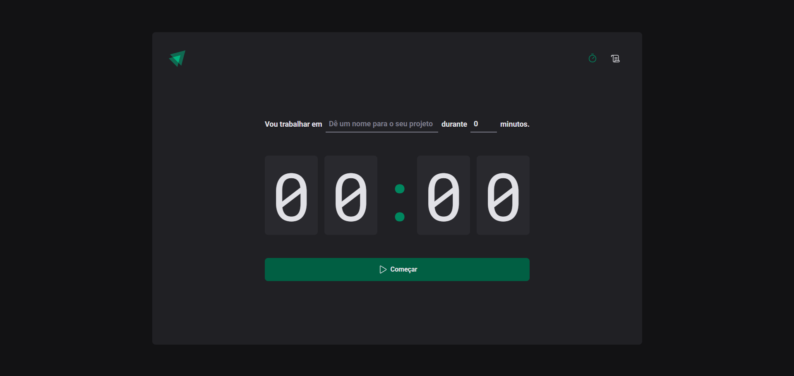

# ⏱️ Ignite Timer — Focus Timer App

Stay focused and track your productivity cycles, one task at a time.



## 📌 About the Project

Ignite Timer is a Pomodoro-style timer application built to help users stay focused on tasks through timed work cycles, with a history log to track completed sessions.

### Features

- ✅ Create new timer cycles linked to a specific task
- ⏳ Real-time countdown with start/interrupt controls
- 📋 Form validation for task creation
- 📅 History of created cycles *(in progress)*

## 🚀 Technologies

- **React.js + TypeScript** — component-based UI development with type safety
- **Vite** — fast build tool and dev server
- **React Hook Form** — form state management and validation
- **date-fns** — date manipulation and formatting
- **React Router** — application routing
- **styled-components** — custom styling with a unique visual identity
- **ESLint** — code quality and standardization

## 🔜 In Development

- Fully functional history page
- Habit/cycle statistics and analytics
- Back-end
- Database
- User authentication
- Cloud deployment

## 💻 Running Locally

```bash
# Clone the repository
git clone https://github.com/guiborgesw/Ignite-Timer.git

# Navigate to the project folder
cd Ignite-Timer

# Install dependencies
npm install

# Start the development server
npm run dev
```

Access at: `http://localhost:5173`

## 👨‍💻 Author

**Guilherme Borges**

- LinkedIn: [linkedin.com/in/guiborgesw](https://www.linkedin.com/in/guiborgesw)